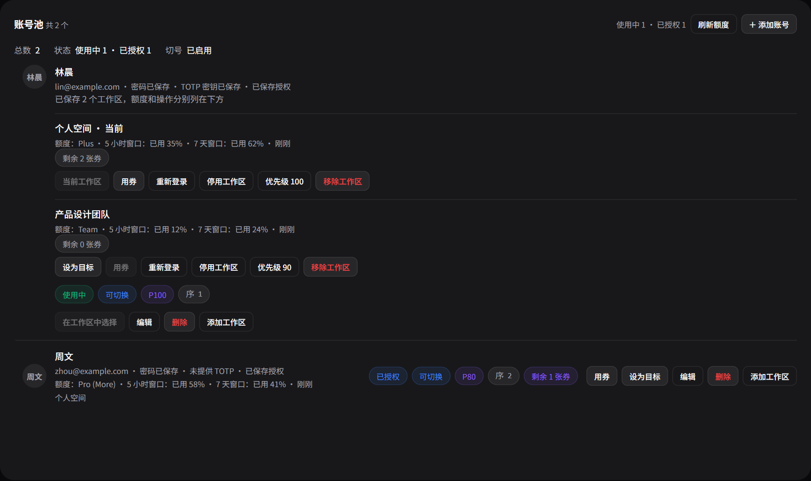
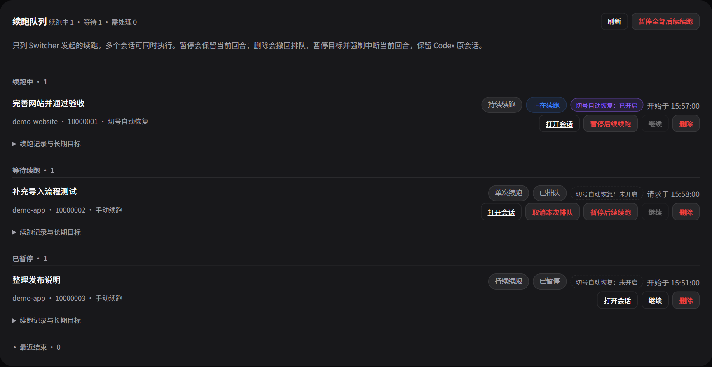

# Codex Switcher

面向 Windows 版 Codex 桌面端的本地多账号管理工具，支持额度监控、自动切换账号和会话续跑。

- **同设备多账号切换**：绕过 Codex 桌面端同一设备的账号数量限制，集中管理多个账号，复用登录快照快速切换。
- **额度监控**：查看各账号的用量、重置时间、剩余重置券和历史走势。
- **Team 工作区**：浏览器授权，同一邮箱的个人空间与多个工作区独立管理。
- **自动切换**：额度耗尽时，按优先级、可用额度和模型权限选择账号。
- **会话续跑**：单次只执行一轮，持续模式由长期目标推进；在续跑队列中查看、暂停、继续或删除任务。

**会话续跑与自动恢复面向 Codex 桌面端。** CLI 可共用账号凭据，终端中的任务需自行管理。详见[支持范围](docs/usage.md#支持范围)。



<details>
<summary>查看续跑队列</summary>



</details>

截图使用示例账号与会话。

## 快速开始

会话续跑需要已安装并运行 Windows 版 Codex 桌面端，Switcher 安装包不包含 Codex。

从 [Releases](https://github.com/Kajiekazz/codex-switcher/releases/latest) 下载 Windows 安装包。普通 Intel / AMD 电脑选择 `x64`，Windows ARM 电脑选择 `arm64`。

1. 安装并打开 **Codex Switcher**，按首次引导检测 Codex、准备登录组件、添加账号。
2. 引导会检测本机已登录的账号，默认勾选导入。添加其他账号时选择普通账号或 Team，并完成授权。
3. 在账号池中切换账号；需要自动切换时，在设置中开启。会话选择「持续续跑」后，默认开启该会话的切号自动恢复。

无需另装 Python、Node 或 Git。自动登录组件首次使用时下载，也可选择手动授权。关闭网页后后台继续运行；托盘菜单可打开管理页、设置开机自启和退出。覆盖安装升级会保留账号与设置。

账号导入格式、Team 授权、自动恢复和开机续跑见[使用指南](docs/usage.md)。开发构建见 [GitHub Actions](https://github.com/Kajiekazz/codex-switcher/actions/workflows/build-windows.yml)。

<details>
<summary>从源码启动</summary>

需要 Windows、Python 3.10+ 和可用的 Codex CLI；可自动检测桌面端随附的 CLI。CLI 用于登录及本地接口调用，会话续跑仍由桌面端执行。基础服务仅依赖 Python 标准库。

```powershell
git clone https://github.com/Kajiekazz/codex-switcher.git
cd codex-switcher
python -m pip install -r packaging/requirements-build.txt
pythonw switcher.pyw
```

打开 [本地管理页](http://127.0.0.1:8787/)，其余操作与安装版相同。退出使用托盘菜单或 `pythonw switcher.pyw --exit`；前台调试和测试命令见[开发指南](docs/development.md)。

</details>

## 详细文档

| 文档 | 内容 |
|---|---|
| [使用指南](docs/usage.md) | 账号导入与登录、手动与自动切换、任务续跑、重置券 |
| [配置与数据](docs/reference.md) | 启动参数、设置优先级、环境变量、数据存储与安全 |
| [浏览器扩展](extension/README.md) | Chrome 侧边栏安装、工具栏徽章与更新 |
| [故障排查](docs/troubleshooting.md) | 服务、登录、额度、切换与续跑问题 |
| [API 参考](docs/api.md) | 本地 HTTP 接口、请求格式与确认要求 |
| [开发指南](docs/development.md) | 源码结构与测试命令 |
| [打包与发布](docs/packaging.md) | Windows 安装包、x64 / ARM64 构建与发布流程 |
| [更新日志](CHANGELOG.md) | 版本变更 |

账号数据保存在本机，凭据使用 Windows 账户加密。存储位置、备份和配置说明见[配置与数据](docs/reference.md)。

## 许可

MIT，见 [LICENSE](LICENSE)。
