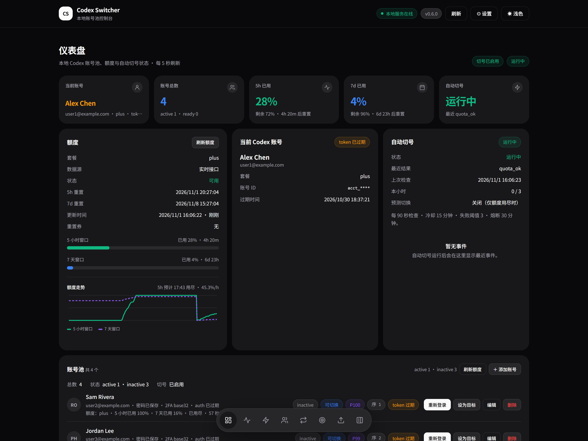
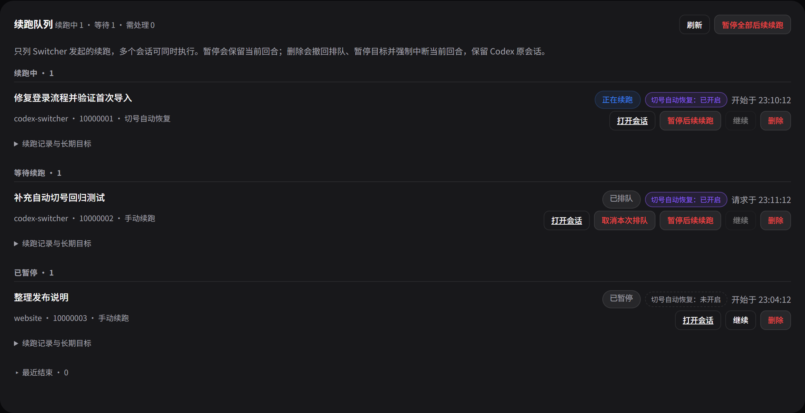

# Codex Switcher

Windows 本地 Codex 多账号管理工具，支持额度监控、自动切换账号和任务续跑。

- **账号管理**：批量导入、设备码登录、加密保存凭据快照。
- **额度监控**：查看 5 小时与 7 天额度、历史走势和耗尽预测。
- **自动切换**：额度用尽后优先选择剩余额度最多的可用账号。
- **会话续跑**：继续一次、切号自动恢复及长期目标管理，集中查看续跑队列。



<details>
<summary>查看续跑队列</summary>



</details>

截图使用示例账号与会话。

## 快速开始

从 [GitHub Actions](https://github.com/Kajiekazz/codex-switcher/actions/workflows/build-windows.yml) 的成功构建中下载对应架构的安装包；正式版本见 [Releases](https://github.com/Kajiekazz/codex-switcher/releases)。

1. 运行 `CodexSwitcher-版本-windows-x64-Setup.exe`；ARM 设备选择 `arm64`。
2. 双击桌面上的 **Codex Switcher**，默认浏览器打开管理页，按首次引导检测 Codex、添加账号并完成授权。
3. 自动登录所需浏览器首次使用时下载；也可选择手动授权。无需另装 Python、Node 或 Git。

关闭网页后后台继续运行。托盘右键可打开管理页、设置开机自启和退出；设置里提供同一个自启开关。账号与配置在覆盖升级后保留。

<details>
<summary>从源码启动</summary>

需要 Windows、Python 3.10+ 和可用的 Codex CLI。基础服务仅依赖 Python 标准库。

```powershell
git clone https://github.com/Kajiekazz/codex-switcher.git
cd codex-switcher
.\start.ps1 -EnableLogin
```

打开 [本地控制台](http://127.0.0.1:8787/)：

1. 在账号池中按 `邮箱|密码|2FA` 格式导入账号。
2. 在登录进度弹窗完成授权；手动模式点击账号行的「登录」，成功后账号即可切换。
3. 选择账号并确认切换，按提示重启 Codex 桌面端。

自动切换、任务续跑、Playwright 登录及托盘操作见[使用指南](docs/usage.md)。

</details>

## 详细文档

| 文档 | 内容 |
|---|---|
| [使用指南](docs/usage.md) | 账号导入与登录、手动与自动切换、任务续跑、重置券 |
| [配置与数据](docs/reference.md) | 启动参数、设置优先级、环境变量、数据存储与安全 |
| [浏览器扩展](extension/README.md) | Chrome 侧边栏安装、工具栏徽章与更新 |
| [故障排查](docs/troubleshooting.md) | 服务、登录、额度、切换与续跑问题 |
| [API 参考](docs/api.md) | 本地 HTTP 接口、请求格式与确认要求 |
| [开发指南](docs/development.md) | 源码结构与测试命令 |
| [打包与发布](docs/packaging.md) | Windows 安装包、x64 / ARM64 构建与发布流程 |
| [更新日志](CHANGELOG.md) | 版本变更 |

服务默认监听 `127.0.0.1:8787`。账号凭据与快照使用 Windows DPAPI 加密，切换前备份当前 `~/.codex/auth.json`，写入失败时尝试回滚并报告结果。详见[配置与数据](docs/reference.md)。

## 许可

MIT，见 [LICENSE](LICENSE)。
