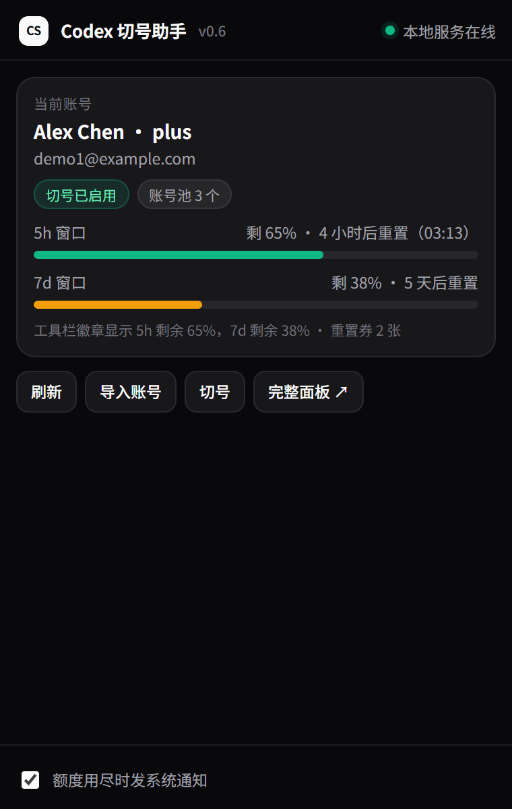

# Chrome 扩展

[返回主 README](../README.md) · [使用指南](../docs/usage.md) · [故障排查](../docs/troubleshooting.md)

Manifest V3 扩展，提供 Codex Switcher 侧边栏、额度徽章和额度耗尽通知。清单声明最低 Chrome 版本为 `114`，需要浏览器支持 `chrome.sidePanel`。



## 安装

1. 在仓库根目录启动本地服务：

   ```powershell
   .\start.ps1 -EnableLogin -EnableSwitch
   ```

2. 打开 `chrome://extensions`，启用「开发者模式」。
3. 点击「加载已解压的扩展程序」，选择仓库中的 `extension/` 目录。
4. 将「Codex 切号助手」固定到工具栏，点击图标打开侧边栏。

也可在[本地控制台](http://127.0.0.1:8787/)的「浏览器扩展」卡片复制安装路径，再在浏览器中完成加载。安装后点击卡片的「重新检测」更新检测结果。

扩展目录必须保留在本机；移动仓库后需从新路径重新加载。旧 Tampermonkey 面板已归档至 `legacy/`，使用扩展时应停用旧脚本。

## 侧边栏操作

- 查看当前账号、5 小时与 7 天额度、重置时间和账号快照。
- 导入账号，选择已有凭据快照的账号并确认切换。
- 访问完整控制台，进行账号登录、自动切换配置和任务续跑。
- 点击「刷新」主动读取状态，并同步更新工具栏徽章。

切换要求本地服务已启用 `-EnableSwitch`。自动切换由本地服务执行，另外需要 `-EnableAutoSwitch`；关闭侧边栏不会停止已启用的服务端监控。账号准备和续跑步骤见[使用指南](../docs/usage.md)。

## 工具栏徽章

数字表示当前账号 **5 小时额度的剩余百分比**。当接口报告额度耗尽时，徽章也会显示红色。

| 徽章 | 含义 |
|---|---|
| 绿色百分比 | 5 小时剩余额度 ≥50% |
| 琥珀色百分比 | 5 小时剩余额度为 20–49% |
| 红色百分比 | 5 小时剩余额度 <20%，或接口报告额度耗尽 |
| `–` 灰色 | 未检测到已登录的本地凭据 |
| `!` 灰色 | 无法完成后台状态刷新，需检查服务或接口连接 |
| `?` 灰色 | 额度读取失败，或缺少可显示的 5 小时额度数据 |

后台每分钟轮询一次，实际时间受浏览器调度影响。悬停可查看当前账号、7 天剩余额度或错误原因。额度由可用变为耗尽时，扩展按通知设置发送系统通知。

## 连接与权限

扩展固定访问 `http://127.0.0.1:8787`，该地址同时写入后台、侧边栏和 `host_permissions`。修改服务端监听地址或端口后，需要同步调整扩展连接地址与权限，否则无法连接。

| 权限 | 用途 |
|---|---|
| `sidePanel` | 显示浏览器侧边栏 |
| `alarms` | 定期刷新工具栏徽章 |
| `storage` | 保存状态缓存和通知设置 |
| `notifications` | 发送额度耗尽通知 |
| `http://127.0.0.1:8787/*` | 调用本地服务接口 |

扩展只向上述本地服务发起请求；账号授权与额度查询由服务端处理。设置优先级、数据存储和凭据加密见[配置参考](../docs/reference.md)。

## 更新与文件说明

更新仓库或修改扩展文件后，在 `chrome://extensions` 重新加载扩展，再重新打开侧边栏。安装、连接和徽章问题见[故障排查](../docs/troubleshooting.md)。

| 文件 | 职责 |
|---|---|
| `manifest.json` | 扩展信息、权限、后台与侧边栏入口 |
| `background.js` | 状态轮询、徽章、通知和本地缓存 |
| `sidepanel.html` | 侧边栏结构与样式 |
| `sidepanel.js` | 直接调用本地服务并处理侧边栏交互 |
| `icons/` | 扩展图标 |
