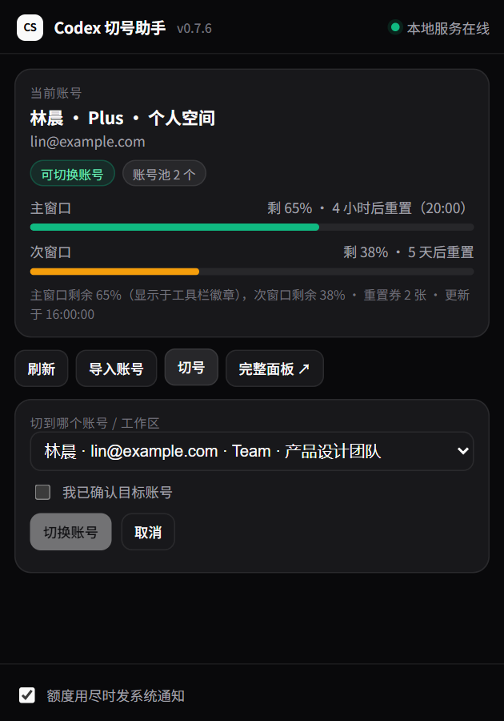

# Chrome 扩展

[返回主 README](../README.md) · [使用指南](../docs/usage.md) · [故障排查](../docs/troubleshooting.md)

在浏览器侧边栏查看账号额度、切换身份，并通过工具栏徽章和系统通知了解额度变化。扩展需配合本地 Codex Switcher 使用，最低支持 Chrome 114。



截图使用示例账号。

## 安装

1. 启动安装版 Codex Switcher；源码用户在仓库根目录运行：

   ```powershell
   pythonw switcher.pyw
   ```

2. 在软件打开的控制台中，找到「浏览器扩展」卡片并复制安装路径。
3. 打开 `chrome://extensions`，启用「开发者模式」，点击「加载已解压的扩展程序」，选择刚复制的路径；源码版可直接选择仓库中的 `extension/` 目录。
4. 将「Codex 切号助手」固定到工具栏，点击图标打开侧边栏。

安装后点击控制台扩展卡片的「重新检测」更新检测结果。

扩展目录必须保留在本机；移动目录后需从新路径重新加载。

## 侧边栏操作

- 查看当前身份、主窗口与次窗口额度、重置时间和已授权身份。
- 导入账号，选择已授权的个人身份或工作区并确认切换。
- 访问完整控制台，进行账号登录、自动切换配置和任务续跑。
- 点击「刷新」主动读取状态，并同步更新工具栏徽章。
- 服务使用自定义端口时，在底部「连接设置」填写控制台地址；留空恢复自动检测。

手动切换默认可用。自动切换在管理页设置中开启，由本地服务执行；关闭侧边栏不会停止已启用的服务端监控。账号准备和续跑步骤见[使用指南](../docs/usage.md)。

## 工具栏徽章

数字表示当前身份**主窗口额度的剩余百分比**，对应额度接口的 `primary_window`。不同套餐的窗口时长可能不同；接口报告额度耗尽时，徽章也会显示红色。

| 徽章 | 含义 |
|---|---|
| 绿色百分比 | 主窗口剩余额度 ≥50% |
| 琥珀色百分比 | 主窗口剩余额度为 20–49% |
| 红色百分比 | 主窗口剩余额度 <20%，或接口报告额度耗尽 |
| `–` 灰色 | 未检测到已登录的本地凭据 |
| `!` 灰色 | 无法读取服务状态，需检查本地服务是否运行 |
| `?` 灰色 | 额度正在查询、查询失败，或缺少可显示的主窗口额度 |

后台每分钟刷新一次，查询尚未完成时会短时跟进，实际时间受浏览器调度影响。悬停可查看当前身份、次窗口剩余额度和缓存状态。额度查询失败时可保留同一身份上次成功的数据并标记时间，不代表本地服务离线。额度由可用变为耗尽时，扩展按通知设置发送系统通知。

## 连接与权限

扩展优先复用上次连接的本地地址，首次连接或连接中断后自动检测 `127.0.0.1` 的 `8787–8797` 端口。检测先验证服务身份，多个请求共享检测结果；服务离线时逐步延长重试间隔，最长 60 秒，正常轮询不重复扫描端口。

若软件使用其他端口，在侧边栏底部展开「连接设置」，粘贴完整面板地址栏中的地址，例如 `http://127.0.0.1:29123`，点击「保存并连接」。仅支持上述格式的本机 HTTP 地址；留空后保存可恢复自动检测。徽章、主题同步和完整面板入口均使用检测到的地址。

切号或导入过程中若连接中断，扩展不会重复提交该操作。先刷新核对结果，再决定是否重新操作。

| 权限 | 用途 |
|---|---|
| `sidePanel` | 显示浏览器侧边栏 |
| `alarms` | 定期刷新工具栏徽章 |
| `storage` | 保存状态缓存和通知设置 |
| `notifications` | 发送额度耗尽通知 |
| `http://127.0.0.1/*` | 验证本机服务并连接实际端口；不允许远程地址 |

扩展只向上述本地服务发起请求；账号授权与额度查询由服务端处理。设置优先级、数据存储和凭据加密见[配置参考](../docs/reference.md)。

## 更新与文件说明

升级安装版、更新仓库或修改扩展文件后，在 `chrome://extensions` 重新加载扩展，再重新打开侧边栏。安装、连接和徽章问题见[故障排查](../docs/troubleshooting.md)。

| 文件 | 职责 |
|---|---|
| `manifest.json` | 扩展信息、权限、后台与侧边栏入口 |
| `background.js` | 状态轮询、徽章、通知和本地缓存 |
| `local-service.js` | 本地服务发现、地址缓存、离线退避与服务身份验证 |
| `sidepanel.html` | 侧边栏结构与样式 |
| `sidepanel.js` | 直接调用本地服务并处理侧边栏交互 |
| `icons/` | 扩展图标 |
